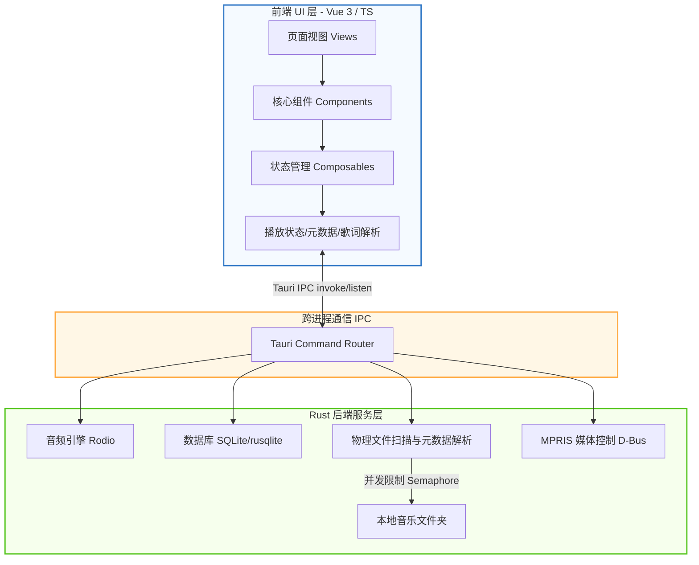

<div align="center">
  

  # Lycia Player for Linux (铃音播放器 Linux 版)

  一款基于 **Tauri v2** 和 **Vue 3** 构建的现代化、高颜值本地音乐播放器的 **Linux 移植版**，聚焦于良好的播放体验、歌词显示和系统集成。

  [](https://github.com/sherkent/LyciaMusic-Linux)
  [](https://github.com/Billy636/LyciaMusic)
  [](https://tauri.app/)
  [](https://vuejs.org/)
  [](https://www.typescriptlang.org/)
  [](https://www.rust-lang.org/)
  [](./LICENSE)

  [](./README_EN.md)
</div>

---

> [!IMPORTANT]
> **关于本项目（Fork 声明）**
>
> 本仓库是 [**Billy636/LyciaMusic**](https://github.com/Billy636/LyciaMusic)（Windows 平台版本）的社区 **Linux 移植分支**，遵循上游的 **AGPL-3.0-only** 开源协议。
>
> - **Windows 用户请使用[原版项目](https://github.com/Billy636/LyciaMusic)**，原版的功能完整度、更新频率与社区支持都更好。
> - 本仓库只维护 Linux 平台适配，会按需同步上游的更新。
> - 关于 Linux 移植的问题请在本仓库提 [Issues](https://github.com/sherkent/LyciaMusic-Linux/issues)；原版功能问题请到[上游仓库](https://github.com/Billy636/LyciaMusic/issues)反馈。
>
> **项目状态：可用（基础核心功能完整）**，部分平台专属功能尚未适配，详见下方[与原版的差异](#-与-windows-原版的差异)。

---

## ✨ 功能亮点

* 🎨 **高颜值沉浸式 UI**
  - **动态背景系统**：提供类似 Apple Music 的液态网格渐变效果，背景颜色可根据当前播放曲目的专辑封面色彩动态演变，同时支持静态模糊与自定义用户皮肤。
  - **毛玻璃与美学视觉**：使用高度精致的半透明磨砂设计，与操作系统原生环境完美融合。
  - **响应式界面排版**：经典侧边栏导航，搭配“抽屉式”播放队列设计，提供极佳的交互体验。

* 🚀 **深度性能优化**
  - **敏捷资源加载**：基于路由的懒加载机制与异步组件挂载，保障界面交互始终保持极高帧率。
  - **安全并发控制**：在 Rust 后端扫描大型音乐库时，采用信号量（Semaphore）对元数据和封面处理进行节流，有效抑制 CPU 突发飙升。

* 🛠️ **系统原生整合**
  - **系统集成**：支持 MPRIS 媒体控制协议（GNOME/KDE 等桌面环境的媒体通知与媒体按键响应）、系统托盘快速操作。
  - **无缝本地管理**：提供高性能的本地音频文件扫描、标签元数据读取和物理文件重命名与整理。
  - **高级交互体验**：自研智能边界检测的上下文菜单，禁用浏览器默认右键行为，提供真正的原生应用质感。
  - **桌面歌词悬浮窗**：轻量化、高性能的桌面浮窗歌词，支持锁定、穿透与自定义样式。
  - **播控悬浮窗**：Windows 版的任务栏播控在 Linux 上以可自由拖拽、记忆位置的悬浮窗呈现。

* 📝 **歌词解析与文件管理**
  - **全格式歌词**：支持音频文件内嵌标签歌词、同名 `.lrc` 文件解析，以及基于 AMLL 的歌词逐字动画渲染。
  - **物理整理与库更新**：内置文件夹管理模式，支持批量重命名预览、外部音频标签编辑器与无感入库刷新。

---

## 📸 界面截图

> 以下截图来自上游 Windows 版本，Linux 版界面与之保持一致。

| 🎵 首页概览 | 💿 沉浸式播放页 |
| --- | --- |
|  |  |

---

## 🐧 与 Windows 原版的差异

### 已完成的 Linux 适配

| 能力 | 说明 |
| :--- | :--- |
| **MPRIS 媒体控制** | 通过 D-Bus MPRIS2 协议对接桌面环境（替代 Windows 的 SMTC），支持系统媒体面板与媒体按键 |
| **凭据安全存储** | WebDAV 等凭据改用 Secret Service（GNOME Keyring / KWallet）存储（替代 Windows 凭据管理器） |
| **RPM 打包** | 支持 `--bundles rpm` 产出 Fedora / openSUSE 安装包（15MB 左右） |
| **播控悬浮窗** | 原版依赖 Win32 任务栏几何 API 的任务栏播控，在 Linux 下降级为右下角自由悬浮窗，支持拖拽与位置记忆 |
| **封面加载修复** | 修复 Tauri asset protocol 在 Unix 上因 `require_literal_leading_dot` 导致 `~/.local/share` 等点目录下的封面无法显示的问题 |
| **WSLg 兼容** | 在 WSL 环境自动禁用 WebKitGTK 加速合成器，规避软件光栅化导致的界面冻结（点击快捷键设置卡死等问题） |

### 暂未适配的功能

| 功能 | 现状 |
| :--- | :--- |
| 系统字体枚举 | Linux 上暂为空实现（自定义字体选择不可用） |
| 应用内自动更新 | 更新检查指向本仓库 Releases，应用内下载安装器仅限 Windows，Linux 请手动下载安装包 |
| WASAPI 独占输出 | Windows 专属特性，Linux 使用 ALSA/PulseAudio 默认输出 |
| 全屏时任务栏自动隐藏 | 依赖 Windows 前台窗口检测，Linux 上不可用 |
| Lyricify 歌词集成 | 依赖 Windows 窗口机制，Linux 上不可用 |

---

## 🛠️ 使用源码运行

### 环境要求

| 依赖项 | 推荐版本 / 要求 |
| :--- | :--- |
| **Node.js** | `>= 18` |
| **Rust** | Stable 稳定版最新版本 |
| **操作系统** | 现代 Linux 发行版（X11 或 Wayland） |
| **WebKitGTK** | `webkit2gtk-4.1` 运行时与开发包 |

Debian / Ubuntu 系安装编译依赖：

```bash
sudo apt update
sudo apt install libwebkit2gtk-4.1-dev build-essential curl wget file \
  libxdo-dev libssl-dev libayatana-appindicator3-dev librsvg2-dev
```

Fedora 系安装编译依赖：

```bash
sudo dnf install webkit2gtk4.1-devel gcc gcc-c++ curl wget file \
  libxdo-devel openssl-devel libayatana-appindicator3-devel librsvg2-devel
```

### 运行与构建步骤

1. 克隆本仓库：

   ```bash
   git clone https://github.com/sherkent/LyciaMusic-Linux.git
   cd LyciaMusic-Linux
   ```

2. 安装前端依赖项：

   ```bash
   npm install
   ```

3. 启动 Tauri 桌面端开发调试：

   ```bash
   npm run tauri dev
   ```

4. 构建生产环境安装包（默认 deb / rpm 等，按发行版选择）：

   ```bash
   npm run tauri build
   # 仅构建 RPM 包（Fedora / openSUSE）：
   npm run tauri build -- --bundles rpm
   ```

5. 在 WSLg 中运行时无需额外配置：应用会自动检测 WSL 环境并禁用 WebKitGTK 合成器，避免软件渲染下的界面冻结。

---

## 📐 技术架构

Lycia Player 采用经典的前后端分离架构，通过 Tauri 提供的 IPC 通道进行高性能的跨进程通信：



- **前端技术栈**：Vue 3 (Composition API)、Vite、TypeScript、Tailwind CSS 4.0
- **后端技术栈**：Rust、Tauri v2.0、SQLite (通过 `rusqlite` 实现音乐库高性能索引)
- **音频播放引擎**：基于 `rodio` 库的底层控制
- **系统集成**：`souvlaki`（MPRIS / D-Bus 媒体控制）、`keyring`（Secret Service 凭据存储）

---

## 💝 特别致谢 (Special Thanks)

- **[LyciaMusic（原版 / Windows）](https://github.com/Billy636/LyciaMusic)**：本项目的全部基础。感谢原作者 [Billy636](https://github.com/Billy636) 与所有上游贡献者打造了这款优秀的播放器，本仓库仅在其成果之上做 Linux 平台适配。
- **[AMLL (Apple Music-like Lyrics)](https://github.com/Steve-xmh/Apple-Music-Like-Lyrics)**：项目歌词部分的渲染与适配，深度参考并改编了 AMLL 项目的优秀实现。

---

## 👥 贡献者名单 (Contributors)

感谢上游项目的所有贡献者 —— 他们的工作是本项目的基础：

<a href="https://github.com/Billy636/LyciaMusic/graphs/contributors">
  
</a>

Linux 移植相关的改动欢迎向本仓库提交 Pull Request。

---

## ⚖️ 许可与资产声明

- **开源协议**：本项目沿用上游的 **AGPL-3.0-only** 许可协议开源。依据 AGPL-3.0 第 5 条，本仓库对原作品所做的修改已在 [NOTICE](NOTICE) 中声明。完整协议内容及歌词改编归属说明请分别参阅 [LICENSE](LICENSE) 与 [NOTICE](NOTICE)。
- **资产版权**：应用 Logo、插图、界面截图等视觉资产均属上游项目作者所有，在本仓库中依据 AGPL-3.0 协议随源码分发、仅用于标识本软件。未经原作者明确授权，请勿将这些图片资产用于任何商业用途或超出协议范围的二次分发。

---

*基于上游 2026-06-08 版本移植；本 README 更新日期：2026-10-19*
