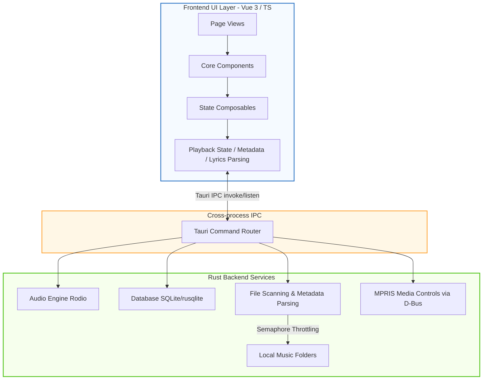

<div align="center">
  

  # Lycia Player for Linux

  A modern, high-performance, and beautiful desktop local music player built with **Tauri v2** and **Vue 3** — this is the community **Linux port** of the original Windows-focused project.

  [](https://github.com/sherkent/LyciaMusic-Linux)
  [](https://github.com/Billy636/LyciaMusic)
  [](https://tauri.app/)
  [](https://vuejs.org/)
  [](https://www.typescriptlang.org/)
  [](https://www.rust-lang.org/)
  [](./LICENSE)

  [](./README.md)
</div>

---

> [!IMPORTANT]
> **About This Project (Fork Notice)**
>
> This repository is a community **Linux port fork** of [**Billy636/LyciaMusic**](https://github.com/Billy636/LyciaMusic) (the Windows version), licensed under the upstream's **AGPL-3.0-only**.
>
> - **Windows users should use the [original project](https://github.com/Billy636/LyciaMusic)** — it has better feature completeness, update frequency, and community support.
> - This repository only maintains Linux platform adaptations and syncs upstream changes as needed.
> - Please report Linux-port issues in this repository's [Issues](https://github.com/sherkent/LyciaMusic-Linux/issues); report issues about the original app in the [upstream repository](https://github.com/Billy636/LyciaMusic/issues).
>
> **Project Status: Usable (core features complete)**. Some platform-specific features are not yet adapted — see [Differences from the Windows version](#-differences-from-the-windows-version) below.

---

## ✨ Key Features

* 🎨 **Aesthetic & Immersive UI**
  - **Dynamic Background System**: Experience fluid, Apple Music-style liquid mesh gradients that evolve based on album art colors. Supports static blur and custom user skins.
  - **Glassmorphism Visuals**: A polished, translucent interface that blends perfectly with your desktop environment.
  - **Responsive Layout**: Sidebar-driven navigation with a docked "Drawer-style" play queue for seamless interaction.

* 🚀 **Performance Optimized**
  - **Smart Loading**: Route-based lazy loading and asynchronous component mounting ensure the app stays snappy.
  - **Concurrency Control**: Concurrency for image processing and metadata extraction during large music library scans is throttled using Rust semaphores to prevent CPU spikes.

* 🛠️ **Native Desktop Integration**
  - **System Integration**: Supports the MPRIS media control protocol (media notifications and media keys on GNOME/KDE and other desktop environments) and system tray quick actions.
  - **Local Management**: High-performance music file scanning, metadata tag reading, and physical file renaming/organization.
  - **Advanced UX**: Custom context menus with smart boundary detection (auto-flip) and disabled browser defaults for a true native app feel.
  - **Desktop Lyrics**: Lightweight, high-performance floating lyrics overlay, supporting window lock, click-through, and style customization.
  - **Playback Control Widget**: The Windows taskbar playback control is presented on Linux as a freely movable floating widget with position memory.

* 📝 **Lyrics & File Management**
  - **All-format Lyrics**: Supports embedded tags, external `.lrc` files, and AMLL-based word-by-word lyrics animation.
  - **Physical Organization**: Built-in folder management mode, batch rename preview, external tag editor, and background library refresh.

---

## 📸 Screenshots

> The screenshots below come from the upstream Windows version; the Linux UI stays consistent with them.

| 🎵 Home Overview | 💿 Immersive Player |
| --- | --- |
|  |  |

---

## 🐧 Differences from the Windows Version

### Completed Linux Adaptations

| Capability | Description |
| :--- | :--- |
| **MPRIS Media Controls** | Integrates with desktop environments via D-Bus MPRIS2 (replacing Windows SMTC), supporting the system media panel and media keys |
| **Credential Storage** | WebDAV and other credentials are stored via Secret Service (GNOME Keyring / KWallet), replacing the Windows Credential Manager |
| **RPM Packaging** | Supports `--bundles rpm` to produce Fedora / openSUSE packages (~15MB) |
| **Playback Control Widget** | The taskbar playback control (which relies on Win32 taskbar geometry APIs) degrades to a freely movable floating widget anchored at the bottom-right, with drag and position memory |
| **Cover Loading Fix** | Fixes Tauri asset protocol failing on covers under dotted directories such as `~/.local/share` due to `require_literal_leading_dot` on Unix |
| **WSLg Compatibility** | Automatically disables the WebKitGTK compositor under WSL to avoid UI freezes caused by software rasterization (e.g. the shortcuts-settings freeze) |

### Not Yet Adapted

| Feature | Status |
| :--- | :--- |
| System font enumeration | Currently a no-op on Linux (custom font picker unavailable) |
| In-app auto update | Update checks point to this repository's Releases; the in-app downloader/installer is Windows-only — download packages manually on Linux |
| WASAPI exclusive output | Windows-only; Linux uses the default ALSA/PulseAudio output |
| Auto-hide taskbar on fullscreen | Relies on Windows foreground-window detection; unavailable on Linux |
| Lyricify lyrics integration | Depends on Windows windowing mechanisms; unavailable on Linux |

---

## 🛠️ Build from Source

### Prerequisites

| Dependency | Recommended Version / Requirement |
| :--- | :--- |
| **Node.js** | `>= 18` |
| **Rust** | Latest stable toolchain |
| **OS** | Any modern Linux distribution (X11 or Wayland) |
| **WebKitGTK** | `webkit2gtk-4.1` runtime and development packages |

Debian / Ubuntu build dependencies:

```bash
sudo apt update
sudo apt install libwebkit2gtk-4.1-dev build-essential curl wget file \
  libxdo-dev libssl-dev libayatana-appindicator3-dev librsvg2-dev
```

Fedora build dependencies:

```bash
sudo dnf install webkit2gtk4.1-devel gcc gcc-c++ curl wget file \
  libxdo-devel openssl-devel libayatana-appindicator3-devel librsvg2-devel
```

### Steps

1. Clone this repository:

   ```bash
   git clone https://github.com/sherkent/LyciaMusic-Linux.git
   cd LyciaMusic-Linux
   ```

2. Install frontend dependencies:

   ```bash
   npm install
   ```

3. Start the Tauri desktop app in development mode:

   ```bash
   npm run tauri dev
   ```

4. Build production packages:

   ```bash
   npm run tauri build
   # RPM package only (Fedora / openSUSE):
   npm run tauri build -- --bundles rpm
   ```

5. When running under WSLg, no extra configuration is needed: the app detects the WSL environment automatically and disables the WebKitGTK compositor to avoid software-rendering freezes.

---

## 📐 Architecture

Lycia Player adopts a classic frontend/backend separation, communicating over Tauri's high-performance IPC channels:



- **Frontend**: Vue 3 (Composition API), Vite, TypeScript, Tailwind CSS 4.0
- **Backend**: Rust, Tauri v2.0, SQLite (via `rusqlite` for high-performance library indexing)
- **Audio engine**: Low-level control based on `rodio`
- **System integration**: `souvlaki` (MPRIS / D-Bus media controls), `keyring` (Secret Service credential storage)

---

## 💝 Special Thanks

- **[LyciaMusic (original / Windows)](https://github.com/Billy636/LyciaMusic)**: The foundation of everything here. Thanks to the original author [Billy636](https://github.com/Billy636) and all upstream contributors for building this excellent player — this repository only adds Linux platform adaptations on top of their work.
- **[AMLL (Apple Music-like Lyrics)](https://github.com/Steve-xmh/Apple-Music-Like-Lyrics)**: The lyrics rendering and adaptations in this project are heavily inspired by and adapted from AMLL.

---

## 👥 Contributors

Thanks to all upstream contributors — their work is the foundation of this project:

<a href="https://github.com/Billy636/LyciaMusic/graphs/contributors">
  
</a>

Pull requests for Linux-specific changes are welcome in this repository.

---

## ⚖️ License & Assets

- **License**: This project is released under the upstream's **AGPL-3.0-only** license. Per Section 5 of AGPL-3.0, modifications made in this repository are declared in [NOTICE](NOTICE). See [LICENSE](LICENSE) and [NOTICE](NOTICE) for the full text and lyrics-related attribution.
- **Assets**: The app logo, illustrations, and screenshots are copyrighted by the upstream project authors; they are distributed here under AGPL-3.0 as part of the project and used solely to identify this software. Do not use these assets commercially or redistribute them beyond the license scope without explicit permission from the original authors.

---

*Ported from the upstream version dated 2026-06-08; this README updated on 2026-10-19.*
